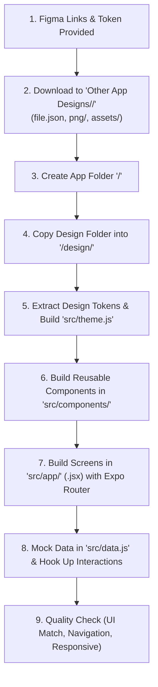

# Mobile App Development Guide (React Native · JS & JSX)

This document is the standard operating manual and architecture guide for developing mobile applications in this workspace from Figma designs. Any AI agent or developer working in this workspace must follow this guide to maintain consistency, design fidelity, and clean code architecture.

---

## 1. Core Tech Stack & Guidelines

| Layer | Technology | Rules / Conventions |
| :--- | :--- | :--- |
| **Framework** | **React Native (0.88+) with Expo (SDK 58+)** | Mobile-first, cross-platform (iOS, Android, Web) |
| **Language** | **JavaScript & JSX (`.js`, `.jsx`)** | Use `.jsx` for all React components/screens, `.js` for utilities, theme, and data |
| **Routing & Navigation** | **Expo Router** (File-based routing) | Routes live strictly in `src/app/`, layouts in `_layout.jsx` |
| **Styling** | `StyleSheet.create` + Design Tokens | Token-driven via `theme.js` (colors, fonts, spacing). No arbitrary hardcoded colors |
| **Icons & Fonts** | `@expo/vector-icons` + Expo Google Fonts | E.g. `@expo-google-fonts/poppins`, Ionicons, Feather |
| **Safe Areas** | `react-native-safe-area-context` | Always wrap screen roots with safe-area insets or `SafeAreaView` |

---

## 2. App Lifecycle: From Figma Design to Finished App



### Stage 1: Design Ingestion
When Figma design links and access tokens are provided:
- Each app's assets and AST are fetched and saved under:
  ```text
  Other App Designs/<AppName>/
    ├── file.json        # Raw Figma node AST
    ├── png/             # Rendered preview screenshots of all artboards
    └── assets/          # Exported vector icons (SVG) and graphics
  ```

### Stage 2: App Project Initialization & Design Transfer
When an app is selected for development:
1. Create a dedicated folder for the app: `<AppName>/`.
2. **Copy the design directory** from `Other App Designs/<AppName>/` into the app's root folder as `<AppName>/design/`.
   - **Target Rule**: Every active or completed app must be self-contained with its own `design/` folder holding `file.json`, `png/`, and `assets/`.
3. Set up the standard directory structure:

```text
<AppName>/
├── design/                   <-- Copied from Other App Designs/<AppName>/
│   ├── file.json             # Figma document AST / metadata
│   ├── png/                  # Screenshots of frames for visual reference
│   └── assets/               # Exported SVG icons and image assets
├── assets/                   # App runtime assets (app icon, splash, images)
├── src/
│   ├── app/                  # Expo Router file-based screens (.jsx)
│   │   ├── _layout.jsx       # Root stack navigation & theme provider
│   │   ├── (tabs)/           # Tab navigator layout and screens
│   │   │   ├── _layout.jsx
│   │   │   ├── index.jsx     # Home / Dashboard
│   │   │   ├── search.jsx
│   │   │   └── profile.jsx
│   │   ├── login.jsx         # Auth screens
│   │   ├── signup.jsx
│   │   ├── onboarding.jsx
│   │   └── details.jsx       # Detail & flow screens
│   ├── components/           # Reusable UI components (.jsx)
│   │   ├── Button.jsx
│   │   ├── Header.jsx
│   │   ├── InputField.jsx
│   │   └── Card.jsx
│   ├── theme.js              # Colors, fonts, spacing, light/dark palettes (.js)
│   ├── data.js               # Mock datasets and initial state (.js)
│   └── utils/                # Helper functions and formatters (.js)
├── app.json                  # Expo config
└── package.json              # Dependencies
```

---

## 3. Design Patterns & Implementation Standards

### 3.1 Design Tokens (`src/theme.js`)
Never hardcode hex codes or font styles across screens. Define a centralized `theme.js`:

```javascript
// src/theme.js
import { createContext, useContext, useState } from 'react';

export const colors = {
  primary: '#3D5CFF',
  secondary: '#FF6905',
  dark: '#1F1F39',
  gray: '#858597',
  lightGray: '#B8B8D2',
  backgroundLight: '#FFFFFF',
  backgroundDark: '#1F1F39',
  surfaceLight: '#F4F3FD',
  surfaceDark: '#2F2F42',
  white: '#FFFFFF',
  error: '#FF4D4F',
  success: '#52C41A',
};

export const fonts = {
  regular: 'Poppins_400Regular',
  medium: 'Poppins_500Medium',
  semiBold: 'Poppins_600SemiBold',
  bold: 'Poppins_700Bold',
};

export const spacing = {
  xs: 4,
  sm: 8,
  md: 16,
  lg: 24,
  xl: 32,
  xxl: 40,
};

export const radius = {
  sm: 8,
  md: 12,
  lg: 16,
  xl: 24,
  full: 9999,
};

export const palettes = {
  light: {
    bg: '#FFFFFF',
    card: '#F4F3FD',
    text: '#1F1F39',
    subText: '#858597',
    border: '#E8E8F0',
  },
  dark: {
    bg: '#1F1F39',
    card: '#2F2F42',
    text: '#FFFFFF',
    subText: '#B8B8D2',
    border: '#383854',
  },
};

const ThemeContext = createContext({
  theme: palettes.light,
  isDark: false,
  toggleTheme: () => {},
});

export const ThemeProvider = ({ children }) => {
  const [isDark, setIsDark] = useState(false);
  const theme = isDark ? palettes.dark : palettes.light;
  const toggleTheme = () => setIsDark((prev) => !prev);

  return (
    <ThemeContext.Provider value={{ theme, isDark, toggleTheme }}>
      {children}
    </ThemeContext.Provider>
  );
};

export const useTheme = () => useContext(ThemeContext);
```

---

### 3.2 Navigation Pattern (`src/app/_layout.jsx`)
Using **Expo Router** with clean stack navigation and Theme Provider:

```jsx
// src/app/_layout.jsx
import { Stack } from 'expo-router';
import { StatusBar } from 'expo-status-bar';
import { SafeAreaProvider } from 'react-native-safe-area-context';
import { ThemeProvider, useTheme } from '../theme';

function RootLayout() {
  const { isDark } = useTheme();

  return (
    <SafeAreaProvider>
      <StatusBar style={isDark ? 'light' : 'dark'} />
      <Stack
        screenOptions={{
          headerShown: false,
          animation: 'slide_from_right',
        }}
      >
        <Stack.Screen name="(tabs)" options={{ headerShown: false }} />
        <Stack.Screen name="login" options={{ headerShown: false }} />
        <Stack.Screen name="signup" options={{ headerShown: false }} />
        <Stack.Screen name="onboarding" options={{ headerShown: false }} />
      </Stack>
    </SafeAreaProvider>
  );
}

export default function App() {
  return (
    <ThemeProvider>
      <RootLayout />
    </ThemeProvider>
  );
}
```

---

### 3.3 Screen Component Pattern (`src/app/index.jsx` or any screen)
Every screen must follow this component structure:
1. Safe area handling
2. Theme consumption
3. Clean header / title
4. Scrollable body (`ScrollView` with `showsVerticalScrollIndicator={false}`)
5. StyleSheet using theme tokens

```jsx
// src/app/login.jsx
import React, { useState } from 'react';
import {
  View,
  Text,
  TextInput,
  TouchableOpacity,
  StyleSheet,
  ScrollView,
  KeyboardAvoidingView,
  Platform,
} from 'react-native';
import { SafeAreaView } from 'react-native-safe-area-context';
import { useRouter } from 'expo-router';
import { colors, fonts, spacing, radius, useTheme } from '../theme';

export default function LoginScreen() {
  const router = useRouter();
  const { theme } = useTheme();
  const [email, setEmail] = useState('');
  const [password, setPassword] = useState('');

  const handleLogin = () => {
    // Navigate to main tabs
    router.replace('/(tabs)');
  };

  return (
    <SafeAreaView style={[styles.safeArea, { backgroundColor: theme.bg }]}>
      <KeyboardAvoidingView
        behavior={Platform.OS === 'ios' ? 'padding' : 'height'}
        style={styles.container}
      >
        <ScrollView
          contentContainerStyle={styles.scrollContent}
          keyboardShouldPersistTaps="handled"
          showsVerticalScrollIndicator={false}
        >
          {/* Header */}
          <View style={styles.header}>
            <Text style={[styles.title, { color: theme.text }]}>Log In</Text>
            <Text style={[styles.subtitle, { color: theme.subText }]}>
              Enter your credentials to continue
            </Text>
          </View>

          {/* Form Fields */}
          <View style={styles.form}>
            <Text style={[styles.label, { color: theme.text }]}>Email</Text>
            <TextInput
              style={[styles.input, { backgroundColor: theme.card, color: theme.text }]}
              placeholder="name@example.com"
              placeholderTextColor={colors.lightGray}
              value={email}
              onChangeText={setEmail}
              autoCapitalize="none"
              keyboardType="email-address"
            />

            <Text style={[styles.label, { color: theme.text, marginTop: spacing.md }]}>
              Password
            </Text>
            <TextInput
              style={[styles.input, { backgroundColor: theme.card, color: theme.text }]}
              placeholder="••••••••"
              placeholderTextColor={colors.lightGray}
              secureTextEntry
              value={password}
              onChangeText={setPassword}
            />

            <TouchableOpacity
              style={styles.primaryButton}
              onPress={handleLogin}
              activeOpacity={0.8}
            >
              <Text style={styles.buttonText}>Log In</Text>
            </TouchableOpacity>
          </View>

          {/* Footer Link */}
          <View style={styles.footer}>
            <Text style={{ color: theme.subText }}>Don't have an account? </Text>
            <TouchableOpacity onPress={() => router.push('/signup')}>
              <Text style={styles.linkText}>Sign Up</Text>
            </TouchableOpacity>
          </View>
        </ScrollView>
      </KeyboardAvoidingView>
    </SafeAreaView>
  );
}

const styles = StyleSheet.create({
  safeArea: {
    flex: 1,
  },
  container: {
    flex: 1,
  },
  scrollContent: {
    padding: spacing.lg,
    flexGrow: 1,
    justifyContent: 'center',
  },
  header: {
    marginBottom: spacing.xl,
  },
  title: {
    fontSize: 28,
    fontFamily: fonts.bold,
    marginBottom: spacing.xs,
  },
  subtitle: {
    fontSize: 15,
    fontFamily: fonts.regular,
  },
  form: {
    width: '100%',
  },
  label: {
    fontSize: 14,
    fontFamily: fonts.medium,
    marginBottom: spacing.xs,
  },
  input: {
    height: 52,
    borderRadius: radius.md,
    paddingHorizontal: spacing.md,
    fontSize: 16,
    fontFamily: fonts.regular,
  },
  primaryButton: {
    marginTop: spacing.xl,
    height: 52,
    backgroundColor: colors.primary,
    borderRadius: radius.md,
    justifyContent: 'center',
    alignItems: 'center',
  },
  buttonText: {
    color: colors.white,
    fontSize: 16,
    fontFamily: fonts.semiBold,
  },
  footer: {
    flexDirection: 'row',
    justifyContent: 'center',
    marginTop: spacing.xl,
  },
  linkText: {
    color: colors.primary,
    fontFamily: fonts.semiBold,
  },
});
```

---

### 3.4 Reusable Component Pattern (`src/components/`)
Components should be self-contained, accept props with defaults, and adhere to `theme.js`:

```jsx
// src/components/PrimaryButton.jsx
import React from 'react';
import { TouchableOpacity, Text, StyleSheet, ActivityIndicator } from 'react-native';
import { colors, fonts, radius } from '../theme';

export default function PrimaryButton({
  title,
  onPress,
  loading = false,
  disabled = false,
  style,
  textStyle,
}) {
  return (
    <TouchableOpacity
      style={[
        styles.button,
        disabled && styles.disabledButton,
        style,
      ]}
      onPress={onPress}
      disabled={disabled || loading}
      activeOpacity={0.8}
    >
      {loading ? (
        <ActivityIndicator color={colors.white} />
      ) : (
        <Text style={[styles.text, textStyle]}>{title}</Text>
      )}
    </TouchableOpacity>
  );
}

const styles = StyleSheet.create({
  button: {
    height: 52,
    backgroundColor: colors.primary,
    borderRadius: radius.md,
    justifyContent: 'center',
    alignItems: 'center',
    paddingHorizontal: 20,
  },
  disabledButton: {
    opacity: 0.5,
  },
  text: {
    color: colors.white,
    fontSize: 16,
    fontFamily: fonts.semiBold,
  },
});
```

---

## 4. Instructions for Future AI Agents & Developers

When assigned to develop an app in this workspace, follow this exact checklist:

1. **Locate the Design**:
   - Check `Other App Designs/<AppName>/`.
   - Inspect `file.json` for node names, layout hierarchy, and colors.
   - Inspect `png/` images to see the exact visual presentation.

2. **Initialize App Directory**:
   - Create `<AppName>/` at the project level.
   - Copy `Other App Designs/<AppName>/` into `<AppName>/design/`.
   - Set up `src/app/`, `src/components/`, `src/theme.js`, and `src/data.js`.

3. **Match Design Accurately**:
   - Copy exact font sizes, line heights, paddings, border radiuses, and shadows.
   - Extract icons from `design/assets/` or match with `@expo/vector-icons`.
   - Support both light and dark themes if both exist in the Figma file.

4. **Verify Implementation**:
   - Ensure all screen transitions and tabs are linked using `router.push()` or `router.replace()`.
   - Run typecheck and lint checks:
     ```bash
     npx expo lint
     ```
   - Confirm all interactive elements (buttons, inputs, cards) respond to taps with active feedback.
